# The build journey

This document follows the prototype as it is built, one checkpoint at a time. It serves two audiences:

- **Presenting:** each checkpoint has a "Show it" click path and the point to make.
- **Reading with the proposal:** each checkpoint says what RSL gains, what was built, what it proves about feasibility, and its honest limits.

The full technical plan lives in [`docs/implementation-plan.md`](../implementation-plan.md); the challenge brief in [`docs/rsl-reference/HANDOFF.md`](../rsl-reference/HANDOFF.md).

---

## Progress at a glance

| # | Checkpoint | What it shows | Status |
|---|---|---|---|
| 0 | Foundation | Officer sign-in, roles, demo calendar, tamper-evident audit log | ✅ Done |
| 1 | RSL's data in one place | Every channel received and traceable to the row | ✅ Done |
| 2 | Patterns and findings | 14 patterns, 17 findings matching the answer key word for word | ✅ Done |
| 3 | Company memory | Earlier decisions shown as context, their conditions checked | ✅ Done |
| 4 | Cases, worklists and triage | Records arrive from a page; cases open, rank and route themselves; officers take and refer | ✅ Done |
| 5 | AI case brief | The AI consolidates every angle into one cited brief; the officer approves, edits or rejects | ✅ Done |
| 6 | The officer's desk | Stages, role desks, hand-offs, information requests, outcomes and sign-off, WhatsApp notifications, Results, a guided tour a judge can take alone | ✅ Done |
| | Rule editing | Only if time remains after the submission | Not started |

---

## The problem, in one paragraph

Revenue Services Lesotho already holds the facts about every multinational group trading here, but they sit in separate systems: income tax returns in eTax, VAT returns, withholding tax schedules emailed as spreadsheets, Lekuka e-invoices, customs declarations, payroll returns and refund letters on paper. No officer sees them side by side, so patterns that only appear when they are joined (fees paid to a parent with no withholding tax, VAT refunds the e-invoices do not support) go unnoticed or take weeks to assemble by hand.

## What the prototype does

It joins each company's records, explains patterns with the exact evidence, remembers what officers decided before, and leaves every conclusion to an officer. **It is not a fraud detector: a pattern is a reason to review, never proof.**

---

## Checkpoint 0: Foundation

**Why it matters.** Tax data demands accountability. Before any analysis, the system must know who is acting, limit what each role can do, and keep a record nobody can quietly change. *(Judging: trust and compliance.)*

**What was built.**
- Officer sign-in with eight roles (risk analyst, refund auditor, Special Sectors auditor, team lead, rule owner, data team, internal audit, administrator) and four teams that cases are routed between.
- A **tamper-evident audit log**: every entry carries the fingerprint of the entry before it, so altering or removing any entry breaks the chain. The database itself refuses edits and deletions, and a single command (`audit:verify`) proves the log is intact.
- A **demo calendar**: "today" is 2 November 2026, and an administrator can move it forward to show what happens days later (taxpayer documents arriving).

**Show it.** Sign in as P. Mokoena (Special Sectors). Point at the date badge at the top: every date in the system follows it.

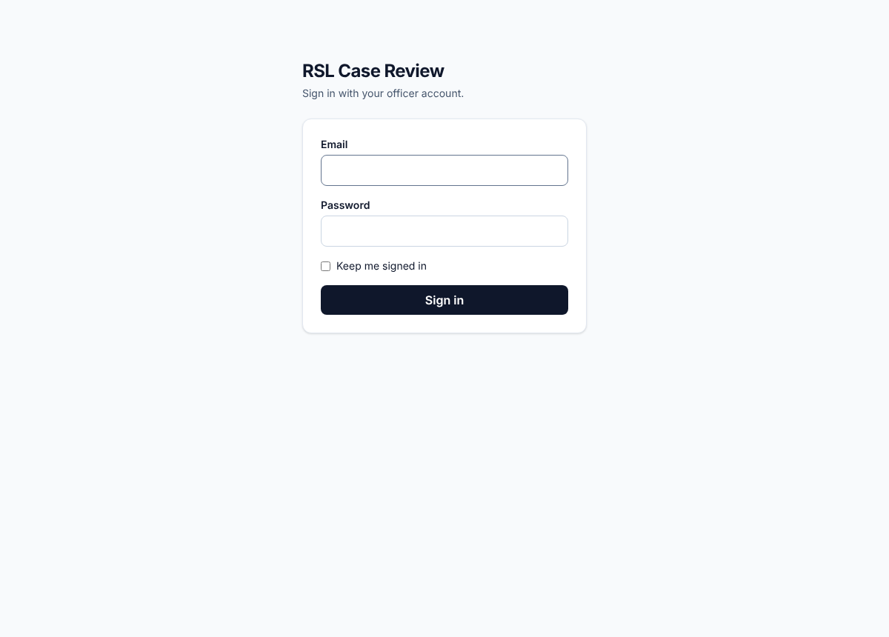

**What it proves.** Accountability is built in from the first line, not bolted on. No blockchain is needed for tamper evidence (handoff rule 14).

**Honest limits.** Removing the very newest log entries can only be detected by comparing with a fingerprint recorded outside the system; `audit:verify` prints it for that purpose.

---

## Checkpoint 1: RSL's data in one place

**Why it matters.** The value of the product starts with joining what RSL already has. *(Judging: value, pilot potential.)*

**What was built.**
- One table per RSL channel (eTax registration, group register, income tax, VAT, withholding tax schedules, Lekuka, customs, PAYE, refund letters), mirroring the source files column for column.
- Every row keeps its public ID (CIT-00036, WHT-00042, RF-0001). **Rows are never edited**: a corrected figure arrives as a new version and the original is kept, so a finding can always show exactly the row it relied on.
- Files are accepted whole or not at all, with a clear reason when rejected, and every receipt is logged.
- Withholding tax schedules carry no payee TIN or country, exactly as in reality; payees are matched to the group register by name.

**Show it.** Home shows what has been received from each channel. Type `CIT-00036` in "Open a record" to see Highveld's 2025/26 return exactly as filed, with where it came from.

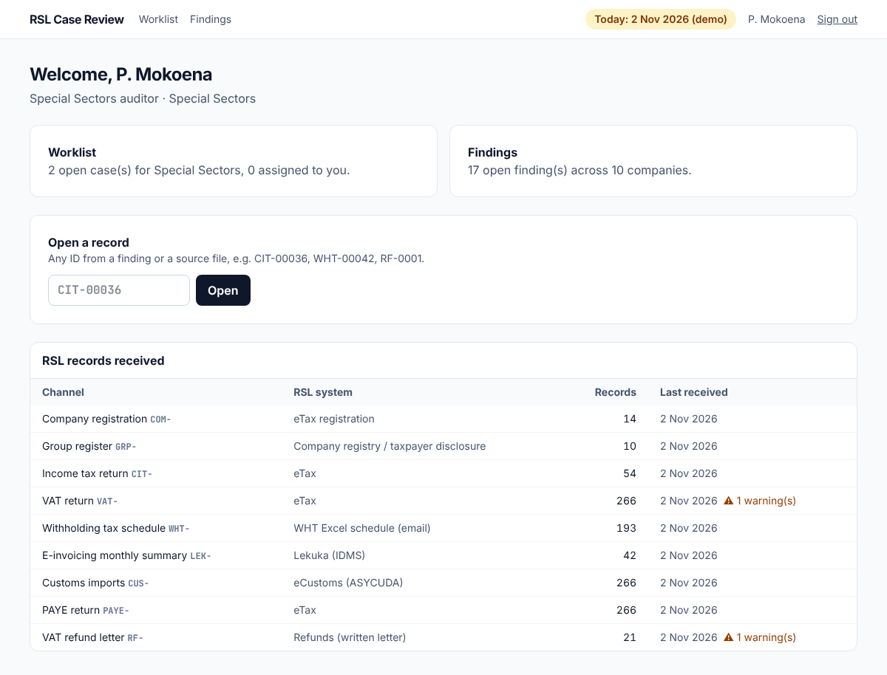

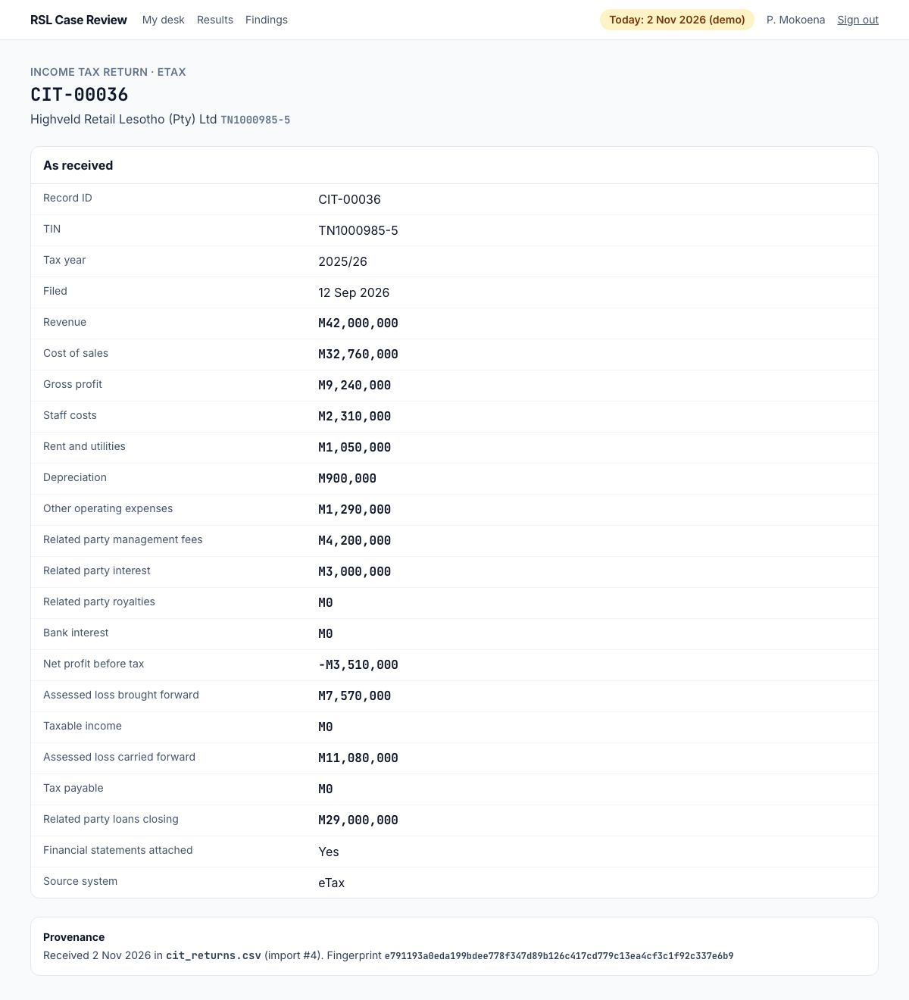

**What it proves.** RSL's existing exports are enough to start; no new taxpayer obligations are needed. In a pilot, the same import runs on files RSL already produces.

**Honest limits.** The data is a mock dataset written for the challenge. Fourteen October VAT returns and three refund letters are dated after the demo's "today"; the system receives them as the answer key expects and flags the date.

---

## Checkpoint 2: Patterns and findings

**Why it matters.** Officers need to know where to look and why. *(Judging: performance and evidence, trust and compliance.)*

**What was built.**
- The 14 patterns of RSL's catalogue run on every company: persistent losses with group charges, fees growing faster than revenue, payments without matching withholding tax, treaty rates claimed for non-treaty countries, imported services without reverse-charge VAT, recurring VAT credits checked against Lekuka and customs (the "green lane"), long-running fixed fees that may hide seconded staff, payments to low-tax jurisdictions, large group interest, profit squeezes, information gaps and possible capture errors.
- Every finding shows **five things**: what the records show, possible lawful explanations, what the officer must establish, an estimated exposure (never an assessed amount), and links to the exact source rows.
- **Wording follows the evidence.** One return alone "may need examination"; two RSL sources that disagree "appear inconsistent with each other". The system refuses to write words such as "evasion", "abuse" or "valid".
- **Every threshold is configuration**, versioned, so a rule owner can change it without a programmer, and every finding records the version that raised it.
- Each analysis keeps a filing review with **all 14 checks, including why the others did not fire**.

**Show it.**
1. Open **Findings**: companies with something to review first, ordinary companies with their one-line summary.
2. Open Thaba Trading's "Fees growing faster than revenue": walk through the five parts, then click a record ID to land on the exact return.
3. Open Tsenola's review ("all 14 checks"): the fees did rise 40%, but revenue rose 35%, so the gap is 5 points and nothing fires. The system explains why it stayed quiet.

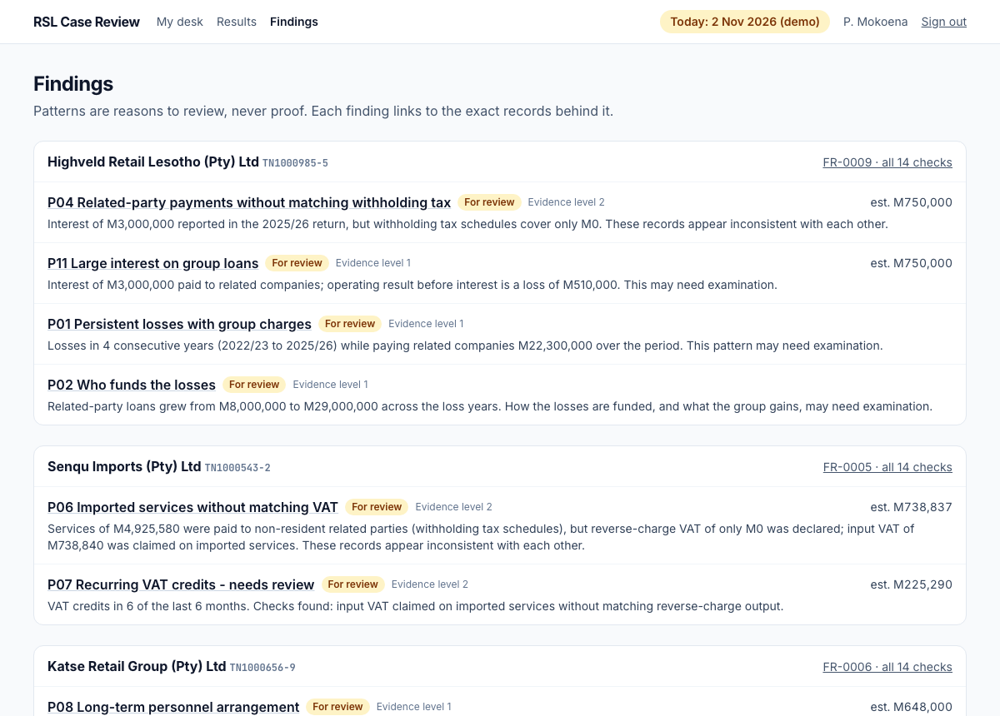

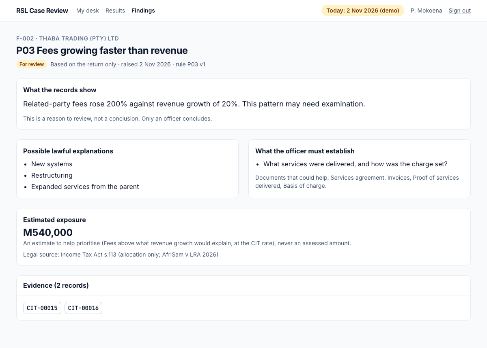

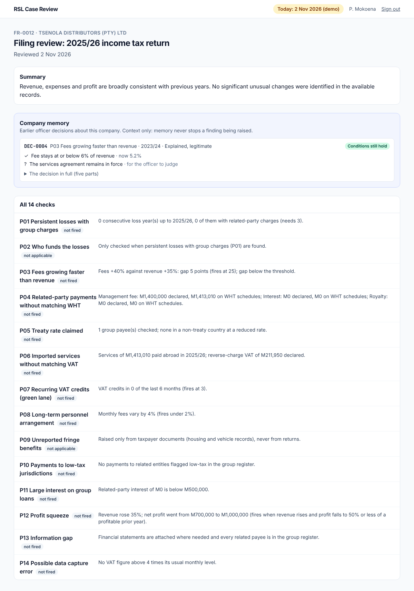

**What it proves.** The analysis reproduces RSL's reference results **exactly**: all 17 expected findings, word for word, with the same estimated exposure and the same cited records, and nothing for the two ordinary companies or the three lawful decoys (apart from Semonkong's lower-risk VAT credits). This is checked automatically on every change.

**Honest limits.** The dataset was written to contain these stories, so matching it shows the workflow behaves as designed. It does not show detection accuracy on real taxpayers.

---

## Checkpoint 3: Company memory

**Why it matters.** RSL loses knowledge when an explained case is forgotten and re-examined from scratch next year, and when a past explanation is wrongly treated as a permanent exemption. *(Judging: value, innovation, trust.)*

**What was built.**
- Earlier officer decisions are loaded as company memory, each stored in **five parts**: what was observed, the conclusion, the evidence, the conditions it holds under, and when to reassess.
- After every analysis, the system checks those conditions against the new figures and says plainly whether the company is still within them.
- **Memory informs, never exempts**: findings are always raised first; memory is shown beside them as context.
- **System errors never enter memory.** The database refuses them; they belong to data review.

**Show it.** Open Qiloane Hardware's "Profit squeeze". The memory panel shows DEC-0007 (2024/25: profit fall explained by a new warehouse). Depreciation and bank interest still match the warehouse explanation, but **related-party fees are now M1.6m against about M0.4m when the decision was made: the pattern has moved beyond what that explanation covers.** Then open Tsenola and Maluti: their earlier decisions still hold (fees 5.2% of revenue against a 6% cap; exports 55% of sales against 50 to 60%).

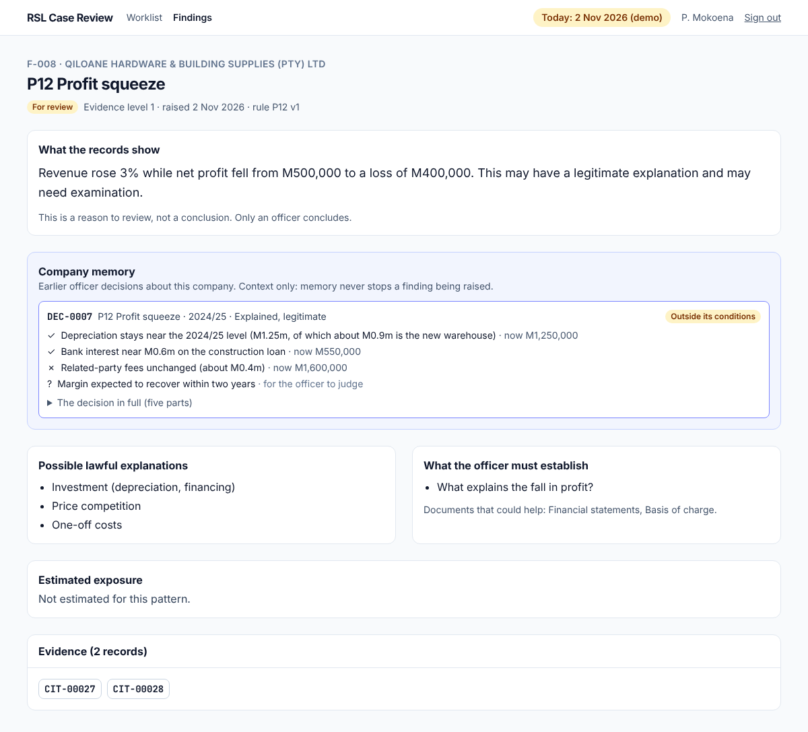

**What it proves.** The system can carry an officer's reasoning forward and test it against new data, without ever letting it switch off scrutiny.

**Honest limits.** The officers' conditions are written in plain English. The team translated them into checkable figures (`database/data/rsl/decision_conditions.json`); that translation is our reading, and the officer's own words are always shown beside it. Conditions that cannot be measured ("margin expected to recover within two years") are left for the officer to judge. New decisions recorded in the app will capture checkable conditions directly.

---

## Checkpoint 4: Cases, worklists and triage

**Why it matters.** Findings only help if they reach the right officer, in the right order, without anyone assembling them. *(Judging: value, usability, pilot potential.)*

**What was built.**
- **Data intake page.** Records enter from a page, not the command line: simulate a company's records arriving from every channel, upload a channel file, or receive everything. From there, nothing is manual: analysis runs, findings are raised, memory is checked and a case opens.
- **Cases open, rank and route themselves.** A company with open findings gets one case; an ordinary company gets only its filing review and creates no work.
  - **Priority** follows the estimated exposure (High from M500,000, Medium from M100,000; both are settings). Estimates for one company often describe the same money (Highveld's M3m interest appears in two findings), so the case shows the largest single estimate, never a misleading sum.
  - **Routing** follows the work: VAT refund claims go to Refund audit (in a *lower risk* or *needs review* lane, never "valid" or "refused"); a company with an earlier decision returns to the team that made it (Qiloane to Special Sectors, who decided DEC-0007); personnel arrangements go to Special Sectors; everything else goes to the risk analysts for triage. Every case says why it was routed where it was.
- **Worklists** per team, ranked by priority, then exposure.
- **Triage.** The officer takes the case or refers it to another team with a reason. Only the team holding a case (or a team lead) can act on it. Closing a case is an officer outcome with reasons, never a plain dismiss (checkpoint 6).
- **A timeline** on every case: opened, taken, referred, findings added or withdrawn, notes. Every step is also in the audit log, and every case opening or referral raises the event WhatsApp notifications will hook into (checkpoint 6).

**Show it.**
1. Sign in as the administrator, open **Data intake**, choose *Thaba Trading* and click **Receive records**: 83 rows arrive from six channels, analysis raises two findings, and CASE-0001 lands on the Risk analysis worklist. Then click **Receive every company**.
2. Sign in as L. Thamae (risk analyst): the worklist shows five cases, highest priority first.
3. Open Thaba: the findings with their evidence, the routing reason, and the next step. Click **Take this case**, then refer it to Special Sectors: "Fees tripled while revenue grew 20%: needs a specialist review of the group charges."
4. Sign in as P. Mokoena (Special Sectors): Thaba is now on their worklist, next to Katse and Qiloane.

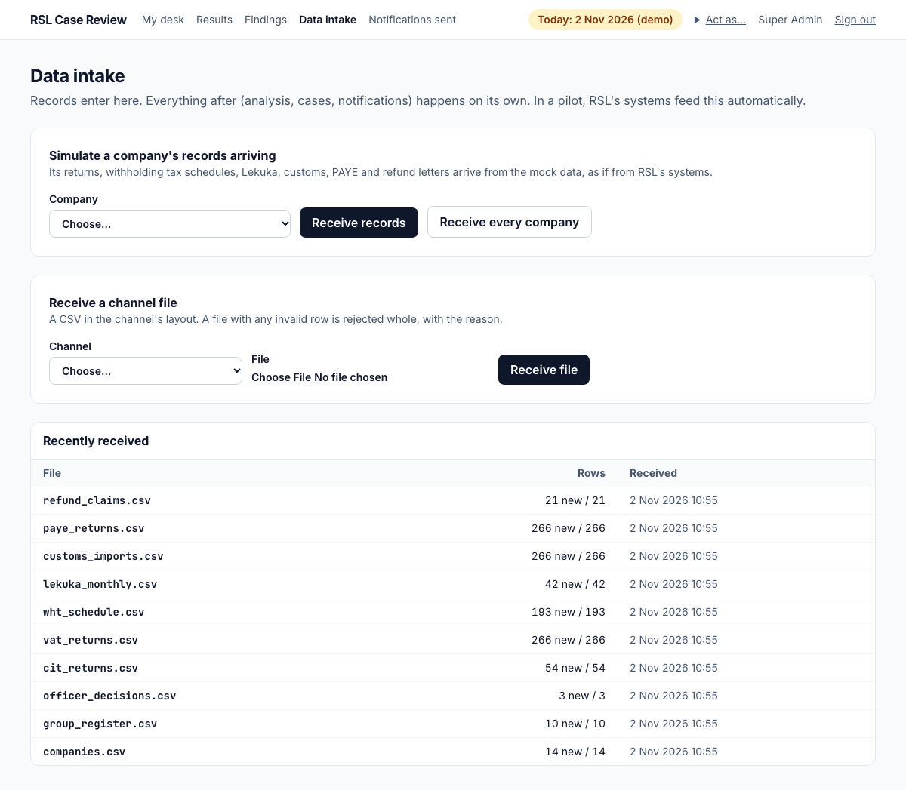

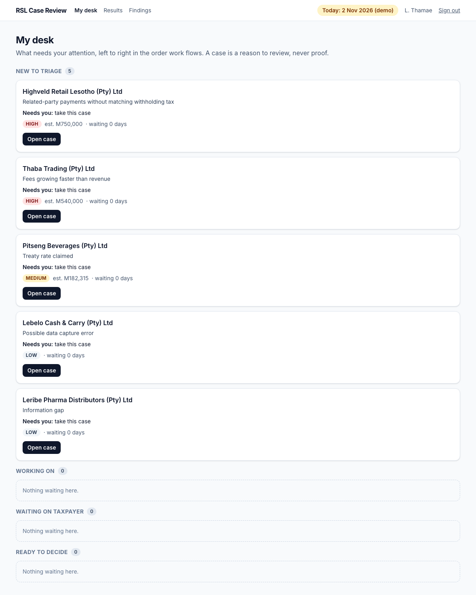

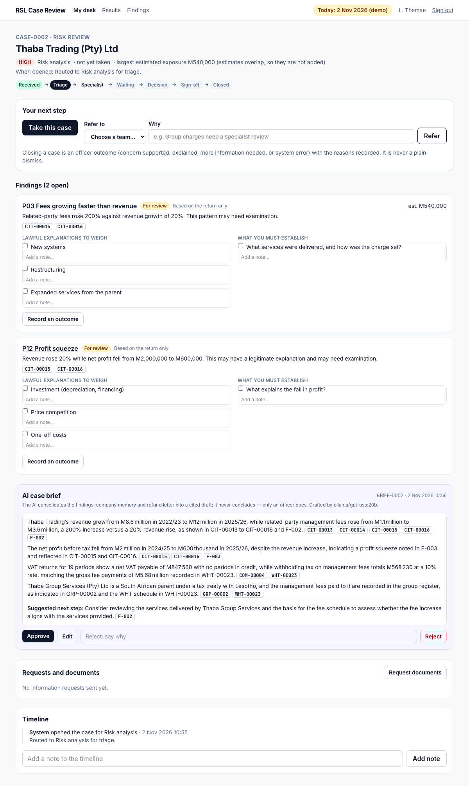

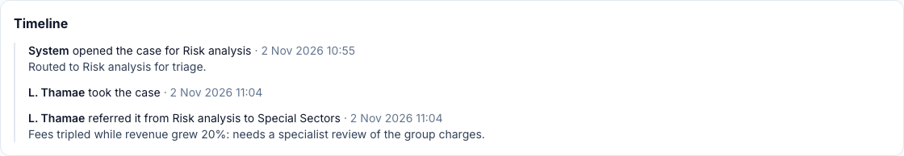

**What it proves.** The system reproduces the answer key's priorities and first-stop teams for all ten companies with findings, and creates no work for the four without. The officer's day starts with a ranked list, not ten spreadsheets.

**Honest limits.** "Simulate a company's records arriving" filters the mock files; in a pilot, the same intake runs on RSL's exports. Thresholds for priority are starting values for RSL to set.

---

## Checkpoint 5: AI case brief

**Why it matters.** A case can carry several findings, a memory check and a refund letter; an officer still has to read all of it before deciding anything. The AI reads it first and writes one short brief, so the officer starts from a summary instead of a pile of records — but the AI drafts, it never concludes, and every sentence has to prove where it came from. *(Judging: value, usability, innovation, trust and compliance.)*

**What was built.**
- **A fact sheet with real figures, not just finding prose.** For each case, the system assembles exactly the records it already looked up, each tagged with its public ID: every finding (with its lawful explanations and what the officer must establish and, inline, what else the system checked on the same filing and found nothing in), every income tax return on file with its actual figures, withholding tax totalled per payee and service with the effective rate worked out, VAT totalled across every period rather than listed one row at a time, the group structure, company memory, and the refund letter. The model sees only this list, and is told explicitly to connect the figures rather than restate each finding on its own.
- **The model drafts in JSON**: a handful of statements and one suggested next step, each with the record IDs it is based on. Runs on **Ollama, hosted inside RSL** (`gpt-oss:20b` in this build), so taxpayer data never has to leave the authority; OpenRouter is wired in as a cloud fallback behind the same provider interface (ported from VENTIQ), chosen by one setting.
- **A guard checks every statement before an officer ever sees it**: any citation that is not one of the fact sheet's IDs, any statement with no citation at all, or any wording `WordingPolicy` would also reject from a finding (the same forbidden words, the same evidence ladder) — the whole draft is rejected, not just the bad sentence. If the model is unreachable or its draft fails, the system falls back to a **deterministic template brief** built from the same facts, with no model call, so the demo (and the officer) never sees a blank or unchecked brief.
- **The officer has the last word.** The case page shows "Drafting…" while the brief is queued, then the cited statements and the suggested next step. The officer **approves** it, **edits** it into their own words, or **rejects** it with a reason — exactly once; the attempt, the model, the prompt hash and text, and the decision are all audited. The brief itself is append-only like a source record: only the review fields may ever change on a drafted row.
- **Drafted on a queue worker, not the request.** Opening or referring a case queues the draft (`composer dev` runs a worker alongside the server); the job is unique per case and generous on timeout, so a slow real model call never risks the page or duplicates a draft.

**Show it.** Open Thaba Trading's case (the one referred to Special Sectors in checkpoint 4). The AI brief sits above company memory: it connects the 40% revenue rise against the 200% fee rise to the profit fall in one statement, works out the withholding tax effective rate, totals the 19 VAT periods instead of listing them, and names the group structure behind the fees — each claim with its record IDs in brackets, and a suggested next step phrased as a suggestion, never an instruction. Click **Approve**.

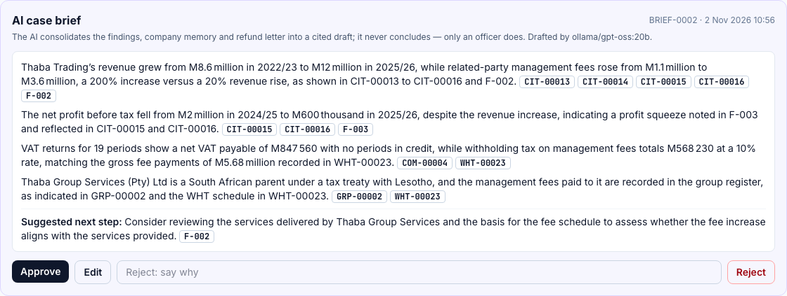

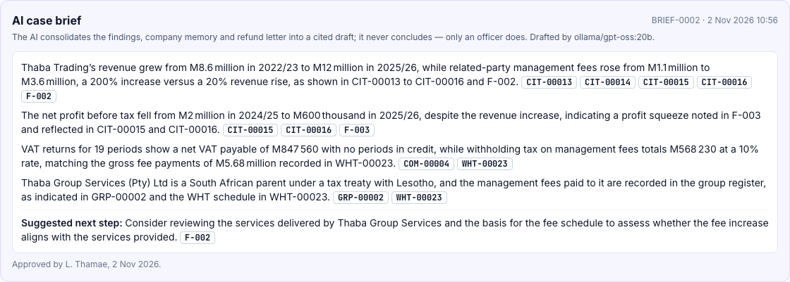

**What it proves.** Run against the real model on the owner's machine with a full queue of ten open cases, nine drafted a valid, grounded brief on the first try; the tenth had the model cite a finding ID that did not belong to that case, and the guard caught it and fell back to the template automatically, exactly as designed — a genuine example of the safety net working, not a staged one. For Highveld (four findings: persistent losses, M22.3m to related parties, loans that grew from M8m to M29m, M3m of interest with no withholding tax), the brief correctly connected all four into a single account of the group financing pattern, citing only real finding and record IDs. The guard was also tested directly: an invented citation, an uncited statement and a forbidden word were each rejected and replaced with the template brief, confirmed with a fake provider in the automated suite.

**Honest limits.** The brief is a summary of records the system already found, not new analysis; a pattern the rule catalogue missed stays missed. Judging real-model prose quality is done by hand, not by an automated test — the automated suite checks grounding and wording, never "is this a good sentence". The guard checks *which* records a statement cites, not *what it claims*: a wrong figure attached to the right citation would still pass today. A later pass is numeric cross-checking (every amount and percentage in a statement verified against the facts it cites) and redrafting a brief when later findings change rather than only on open or referral.

---

## Checkpoint 6: The officer's desk

**Why it matters.** A case that opens, gets found and gets a brief still has to reach the right person, carry a document request, wait on a taxpayer, get a decision and (above a threshold) a second signature — and a judge has to be able to follow all of that **alone**, on the hosted link, without a presenter. This checkpoint folds what were separately planned as WhatsApp notifications, information requests and officer outcomes into one build: the stage a case is actually in becomes the backbone the desk, the hand-off note, the notification and the Results count all read from. *(Judging: value, usability, trust and compliance, pilot potential — and this is where AI and WhatsApp, the two selling points, meet the rest of the workflow.)*

**What was built.**
- **A front page, demo mode only.** Three sentences on what this is and that the system never concludes, a card per officer with no password ("Where should I look?", "Can I process this refund confidently?", "What is happening in this company?", "Can I sign this off?", "Is this figure wrong?"), **Take the guided tour**, and **Reset the demo**. An administrator still signs in with a password, and can **Act as** any officer from the header menu — a slim amber banner always says who they are acting as, and every audit event records both the administrator and the officer.
- **Case stages are the backbone**: `triage → specialist → waiting_taxpayer → decision → signoff → closed`, plus the existing open/closed status. Every stage change writes a case event and an audit event. A **journey strip** on every case shows the full path, the current stage, and stages a case skipped (Special Sectors, for a case that never needed it) shown faint rather than hidden.
- **A desk per role**, replacing one flat worklist: lanes left to right in the order work actually flows (Risk analysis: New to triage → Working on → Waiting on taxpayer → Ready to decide; Special Sectors: Handed to us → Investigating → Waiting on taxpayer → Documents arrived; Refund audit: Lower risk → Needs review → Verification due soon; Team lead: Waiting for my sign-off → Returned, plus a read-only team overview; Data team: Figures to check). Empty lanes say "Nothing waiting here" rather than showing nothing. Each card states **what is needed from you** — take the case, or the hand-off note from whoever referred it — in plain language, never a status code.
- **One case workspace**, not a maze of tabs: header with stage, holder and the hand-off note styled as a note on the desk; the journey strip; the AI brief (checkpoint 5); findings with tickable lawful explanations and what must be established; **requests and documents**; the outcome form; company memory and the timeline, in that order, with one main button for the next step.
- **Information requests and documents (thin checkpoint 7).** The request composer prefills from the open findings' own list of documents to ask for, deduplicated and editable; sending moves the case to `waiting_taxpayer` and schedules delivery against a simulated pool of the taxpayer's own documents — asking for something nobody has just gets no delivery, honestly. Advancing the demo clock releases whatever is due: Katse Retail Group's documents raise a **new finding, P09, at the evidence ladder's top level** ("Taxpayer documents received"), because what was declared does not match what arrived.
- **Officer outcomes and second sign-off (thin checkpoint 8).** Four outcomes — concern supported, explained, more information needed, system error — each with the same five parts as company memory (observed pattern, conclusion, evidence, conditions, reassessment point). Closing a finding as "explained, legitimate" at or above the sign-off threshold goes to a team lead's queue. RSL's default is M1,000,000; no story in the mock data reaches it, so **the demonstration asks for a second sign-off on every "explained, legitimate" closure**, and every screen that relies on it says so; approving writes it into company memory for the next officer who meets this company; returning it sends it back with a note. A **system error** outcome never touches company memory — it opens a data review item for the data team instead. **More information needed** is recorded with its reasons but is not final: the finding stays open and the case keeps waiting.
- **WhatsApp notifications, with no taxpayer detail, ever.** Every hand-off (a case opens for a team, is referred, documents arrive, an outcome needs sign-off) tries to send a templated WhatsApp message naming only the case reference and priority — never a company, a TIN or an amount. The **Notifications sent** page (gated to team leads and audit roles, the same people who can see the audit log) lists every attempt and its real status; only a verified test number is actually delivered, everything else is honestly marked "not delivered (demo number)" rather than faked.
- **A Results tab**: findings concluded, exposure referred for investigation, refunds verified within the 3-month standard, average days open to close, and — the concept's feedback loop — how often each pattern ended "concern supported" against "explained". A summary of work done, not a scoreboard of taxpayers flagged.
- **A guided tour and a nightly reset**, so a judge needs nobody in the room. The tour is a floating panel ("Step N of 10") that switches officer when a step needs it, and walks RSL's three required case types: an ordinary company with nothing raised, an exception handed from Risk analysis to Special Sectors with the AI brief read along the way, requests sent and the calendar moved forward from the panel itself (a judge is never signed in as the administrator), documents arriving to raise a new finding, a human decision, an information gap closed as explained and signed off by a team lead, memory tested against new figures (Qiloane, DEC-0007), a figure that looks wrong, and every notification the hand-offs raised. Officers land on their own desk, which names who they are. **Reset the demo** (and a nightly scheduled reset) wipes the database and reloads the registry, memory and every company's records, with the clock back at 2 November 2026 — a judge who breaks something can always start over. A reset never messages anyone's phone.

**Show it.** From the front page, **Take the guided tour**. Step 2: L. Thamae's desk, Thaba Trading under "New to triage", its AI brief, handed to Special Sectors with a reason; Leribe's documents requested. Step 3: P. Mokoena's desk, Thaba under "Handed to us" with L. Thamae's note; requests sent for Thaba and Katse. Step 4: **Move the calendar forward 14 days** from the tour panel — the documents arrive, and Katse gets a new finding (P09): "Taxpayer documents (DOC-009, Lease and fleet register) show company-leased houses in Maseru West and two company vehicles for the managers, while the PAYE returns declare fringe benefits of M1,370." Step 5: record the officer's decision on it. Steps 6–7: Leribe closed as explained, then signed off by M. Sello. Step 10: Notifications sent (every WhatsApp attempt, in the approved template wording, with no taxpayer detail) and Results.

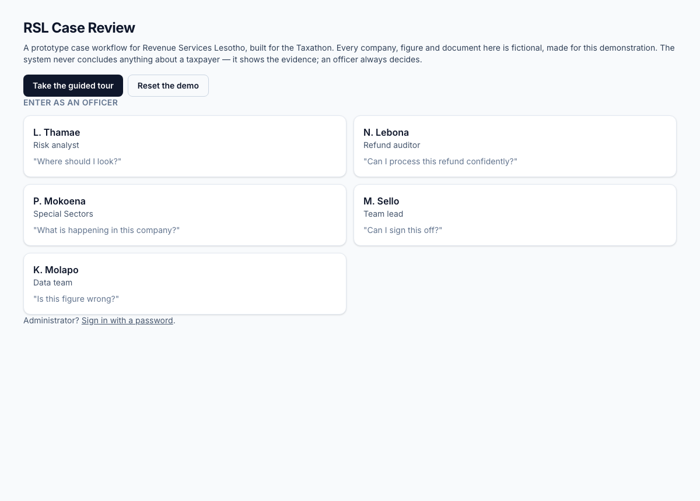

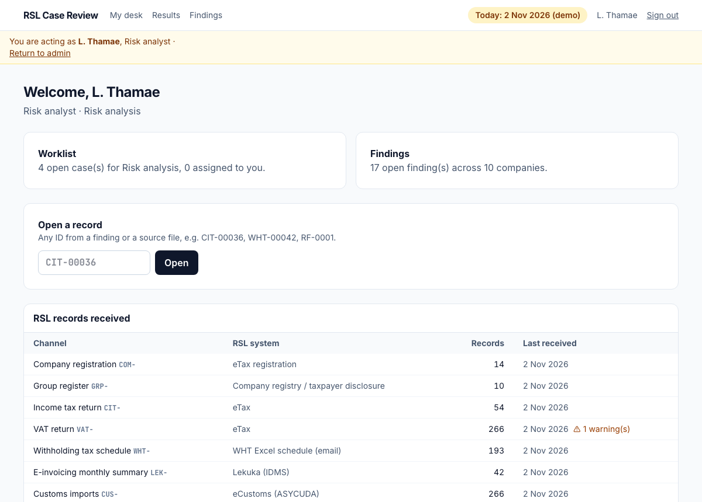

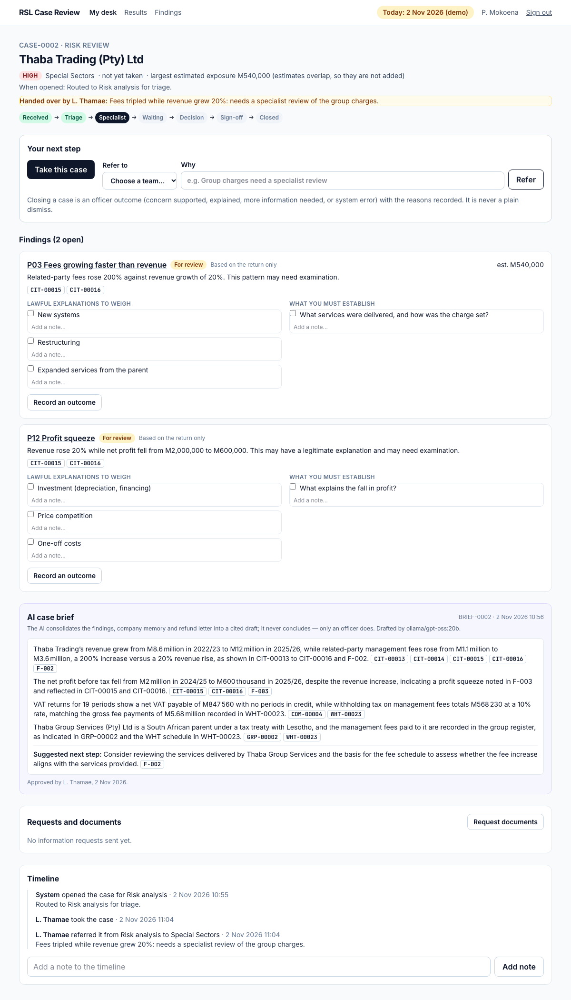

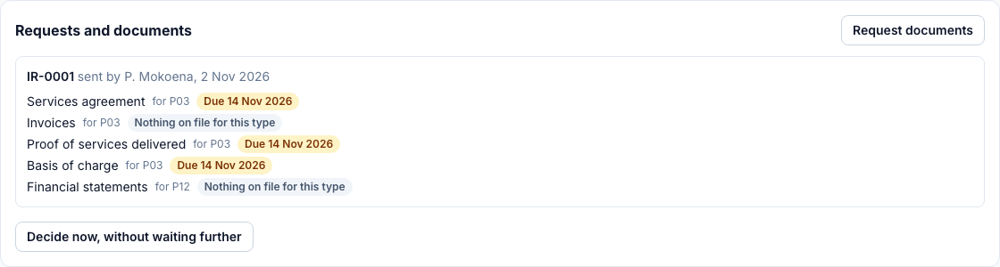

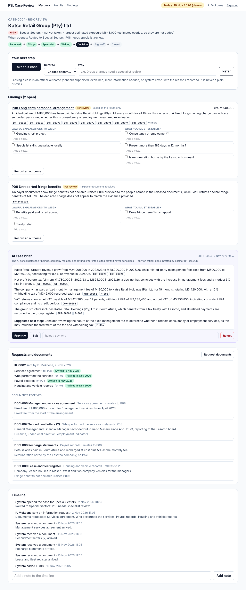

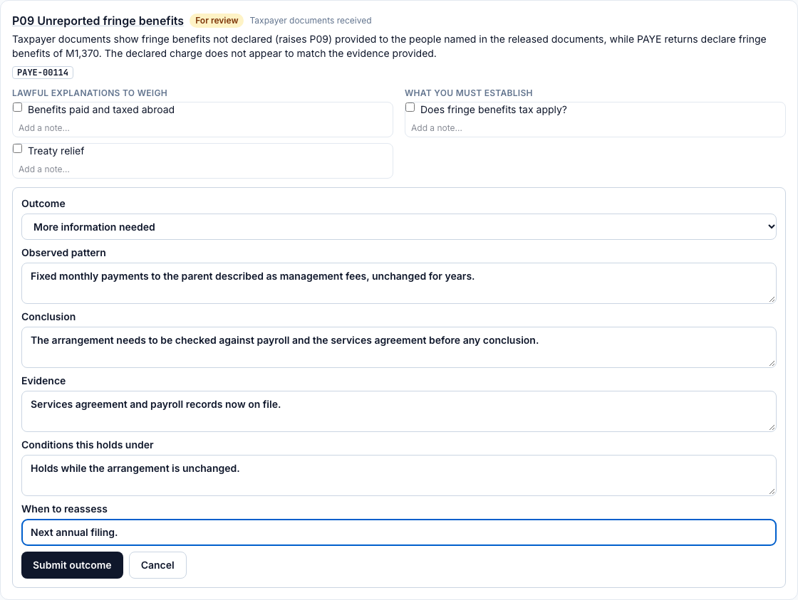

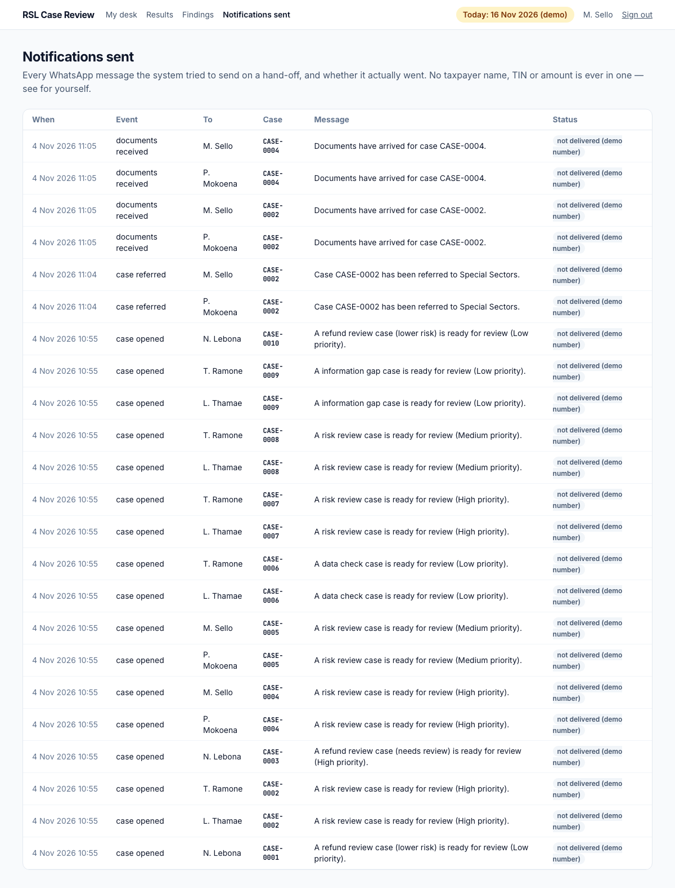

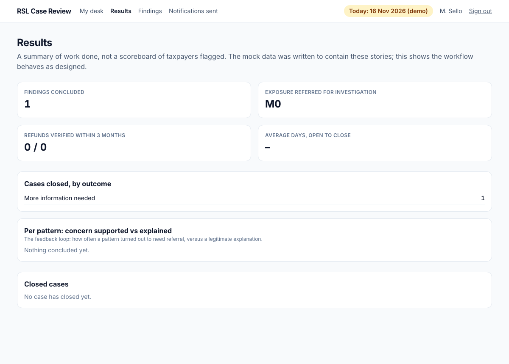

**What it proves.** The whole shape RSL asked for — evidence to a case, a case to the right desk, a request to a document, a document to a new finding, a decision to memory, a hand-off to a WhatsApp message — works end to end on the real mock data, and a stranger can walk it without anyone explaining it first.

**Honest limits.** Editing the AI brief, a checklist note or a referral reason in place, and letting an officer add a finding the rules missed, are designed (officer-desk.md section 5) but not yet built — today those are edited by rejecting and redrafting, or a note on the timeline. "Act as" and the front page are a demo convenience behind `RSL_DEMO`, never a production login path. The sign-off threshold is lowered for the demo because no mock company reaches RSL's real M1,000,000; the page says so plainly. WhatsApp sending is real (Meta's Cloud API, behind a provider interface), but only a verified test number actually receives a message in this environment — everything else is honestly marked undelivered rather than simulated as sent.

---

## Coming next

**Rule editing** with a full 53-step workflow trace is designed but not built — only if time remains after the submission.

**Ask the records** is built: a chat, on its own page and on every case page, answered only from the records with every statement cited. The question is looked up in the records first; the AI model (Ollama, so data stays inside RSL) may only word an answer from what was found, and a guard rejects any invented citation, any figure not in the records and any conclusion-wording. If the model is unreachable or fails the guard, the answer comes straight from the records, so the chat always works. It answers the five questions in the brief (related-party increases at a 30% threshold: Thaba +200%, Qiloane +300%, Tsenola +40% under DEC-0004; why Highveld was flagged; recurring VAT credits and lower risk; Qiloane's earlier review; low-tax jurisdictions). Every question and answer is stored and audited.

---

## The honesty statement (for the demo and the submission)

The mock data was written to contain these stories. Passing the acceptance tests shows the workflow behaves as designed; it does not show detection accuracy on real taxpayers. A pilot on RSL's own historical cases, where outcomes are known, is how accuracy would be measured.
